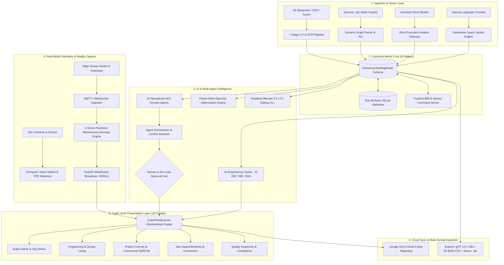

# BuildSphere AI Version 3.0 — Master System Architecture & Functional Analysis Document

**Project**: BuildSphere AI (Version 3.0.0)  
**Classification**: Unified Cyber-AEC Operating System  
**Last Updated**: September 2026  
**Document Type**: Complete Functional, Architectural, Data Flow & Operations Specification

---

## 1. Executive Summary & Core Platform Mission

**BuildSphere AI Version 3.0** is an enterprise-grade, cloud-native Cyber-AEC (Architecture, Engineering, Construction, and Operations) Operating System. It bridges the traditional industry fracture between conceptual architectural modeling, structural civil engineering, MEP coordination, 5D cost forecasting, real-time site execution, and post-handover facility digital twins.

Unlike conventional AEC software suites that rely on manual file exports (DWG, RVT, IFC, PDF, XLSX) across fragmented silos, BuildSphere AI maintains a **Unified Metric Metric (SI) Canonical Building Model** that acts as the single source of truth across all 26 industry roles.

---

## 2. High-Level System Architecture



---

## 3. Core Project Functions & Real-World Operations

### A. Architectural Conception & Generative Space Syntax
* **Text-to-BIM Synthesis**: Translates natural language prompts (e.g., *"3-story brutalist concrete office with solar roof and double-height lobby"*) into geometric coordinates, structural bay divisions, and material property sets.
* **2D Blueprint Vectorization**: Converts raw raster blueprints (PNG, JPG, PDF) into metric 3D BIM models with structural foundation pads, floor slabs, interior/exterior walls, true doorway cutouts, windows, and perimeter safety parapets.

### B. Engineering Code Compliance & Structural Auditing
* **Statutory Verifications**: Automated compliance testing against:
  * **IS 456:2000**: Code of Practice for Plain and Reinforced Concrete.
  * **National Building Code (NBC 2024)**: Fire egress widths, setback distances, and FAR/FSI calculations.
  * **IS 13920:2016**: Ductile design and detailing of reinforced concrete structures subject to seismic forces.
  * **ACI 318 & BS EN 1992**: Eurocode / US structural concrete standards.
  * **LEED v4.1 & GRIHA**: Green building certification and embodied carbon targets ($kg\text{ CO}_2e/m^3$).

### C. Construction Site Execution & Workforce Tracking
* **Daily Progress Records (DPR)**: Aggregation of workforce headcounts across 5 trades (engineers, supervisors, skilled trades, unskilled labor, equipment operators).
* **Field Work Inspection Requests (WIR)**: Mobile sign-offs for rebar reinforcement, concrete pre-pour checklists, and curing tests.
* **Issue & Risk Lifecycle Management**: End-to-end tracking for RFIs (Request for Information), NCRs (Non-Conformance Reports), snags, risks, and change orders.

### D. 5D Quantity Takeoff (QTO) & EVM Cost Governance
* **Automated Takeoff Engine**: Instant calculation of concrete volume ($m^3$), rebar reinforcement tonnage (MT), internal plaster area ($m^2$), and glazing unit counts.
* **Earned Value Management (EVM)**: Live tracking of:
  $$\text{Cost Performance Index (CPI)} = \frac{\text{EV}}{\text{AC}}$$
  $$\text{Schedule Performance Index (SPI)} = \frac{\text{EV}}{\text{PV}}$$
* Generates Estimate at Completion (EAC) and Estimate to Complete (ETC) S-curves.

### E. 3D Digital Twin & Predictive Maintenance
* **Live IoT Telemetry**: Streaming vibration, strain gauge, and temperature metrics at 50ms intervals.
* **Predictive Maintenance**: Statistical rolling $Z$-score anomaly model detects chiller bearing degradation, pump cavitation, and structural strain anomalies up to 14 days prior to critical failure.

### F. Automated Cloud Reporting & Headless 3D Mesh Baking
* **Google Docs Integration**: Automatic generation of executive, safety, and commercial reports into Google Docs using verified Google Cloud OAuth2 credentials (`buildsphere-ai-503703`).
* **Headless Blender 5.2 LTS Execution**: Invokes headless Blender via background CLI to bake procedural models into native `.blend` and `.fbx` formats.

---

## 4. Data Sharing, Pipelines & Information Flow

### A. The Canonical Building Model as the Single Source of Truth
The architecture rejects proprietary lock-in. Neither raw 2D pixel coordinates nor transient WebGL meshes act as the source of truth. All subsystems interface through a strict metric schema (`backend/app/schema/building_model.py`):

```python
BuildingModel
├── id: str
├── name: str
├── units: "m" | "cm" | "mm" | "ft" | "in"
├── scale_px_per_meter: float (default: 80.0)
├── floors: List[Floor]
│   ├── level: int
│   ├── elevation: float (Y-axis)
│   ├── height: float
│   ├── walls: List[Wall]
│   │   ├── start_point: Point2D(x, z)
│   │   ├── end_point: Point2D(x, z)
│   │   ├── thickness: float (e.g. 0.20m)
│   │   ├── wall_type: "exterior" | "interior" | "load_bearing" | "curtain"
│   │   └── openings: List[WallOpening(offset_start, width, height, sill_height)]
│   ├── doors: List[Door]
│   ├── windows: List[Window]
│   ├── rooms: List[Room(polygon: List[Point2D], area, perimeter, room_type)]
│   └── stairs: List[Stair(riser, tread, step_count, direction)]
└── metadata: Dict[str, Any]
```

### B. State Management & Real-Time Sync Topology
1. **Zustand Client Store** (`frontend/src/store/`):
   * `bimStore.js`: Holds active 3D element selections, materials, layer visibility, and transforms.
   * `historyStore.js`: Implements the Command Pattern for atomic Undo/Redo across all design actions.
   * `uiStore.js`: Manages viewport mode (Wireframe, X-Ray, Ghost, Shaded), discipline filters, and HUD states.
2. **FastAPI WebSocket Telemetry Pipeline**:
   * Continuous bi-directional channel at `/api/twin/ws/iot-telemetry`.
   * Pushes randomized or field-connected MQTT telemetry packets every 2 seconds to synchronize browser 3D gauges.
3. **Cross-Role Data Bus**:
   * An NCR submitted by the **Chief Inspector** writes to `issues` table via `POST /api/issues`.
   * Triggers an automated notification dispatch via `POST /api/notifications/broadcast`.
   * Reflected in real time on the **General Contractor**, **Site Engineer**, and **Project Manager** HUD drawers.
4. **Historical Snapshots & Instant Rollback**:
   * Revisions are archived as immutable JSON strings in the `model_versions` table.
   * Enables one-click restoration to any historical design baseline via `POST /api/buildings/{id}/versions/{v_id}/restore`.

---

## 5. Computer Vision & OCR 2D-to-3D Pipeline

The blueprint processing pipeline (`backend/app/cv_pipeline/`) consists of 7 modular stages:

| Stage | Module | Algorithmic Implementation | Output / Artifact |
| :--- | :--- | :--- | :--- |
| **1. Preprocessing** | `preprocessor.py` | Bilateral filtering, Otsu adaptive thresholding, morphological opening/closing, Radon deskewing. | Normalized, noise-free binary raster image. |
| **2. OCR & Text Extraction** | `ocr_provider.py` | EasyOCR & Tesseract engines; regex heuristics for room identifiers (`BEDROOM`, `LIVING`, `KITCHEN`) and dimensions (`7.50 m`, `14'-6"`). | Bounding boxes, text strings, and confidence scores. |
| **3. Geometry Detection** | `geometry_detector.py` | Canny edge detection, Probabilistic Hough Line Transforms, Ramer-Douglas-Peucker line simplification, orthogonal snap grid. | Vectorized wall centerline segments with thickness estimates. |
| **4. Aperture Detection** | `aperture_detector.py` | Circular arc fitting for door swings; multi-line parallel clustering on exterior walls for window openings. | Door swing arcs, hinge positions, and window wall aperture offsets. |
| **5. Room Detection** | `room_detector.py` | Morphological wall dilation followed by spatial flood-fill and contour extraction into closed polygons. | Watertight room polygons with surface area ($m^2$) and perimeter ($m$). |
| **6. Scale Calibration** | `scale_calibrator.py` | Computes ratio between pixel distances of witness lines and OCR dimension numbers; supports manual 2-point calibration. | Metric conversion factor (pixels per meter, e.g. $80.0\text{ px/m}$). |
| **7. Topology Validation** | `topology_validator.py` | Enforces T-junction wall connectivity, closes gaps $< 150\text{mm}$, removes self-intersections, validates room enclosures. | Fully validated, certified `BuildingModel` entity. |

---

## 6. Artificial Intelligence, Multi-Agent Suite & ML Models

### A. The 18 Specialized AEC Domain Agents
Implemented in `backend/app/agents/specialized_agents.py`, all agents inherit from `AECAgent` with strict action boundaries (`READ`, `ANALYZE`, `SUGGEST`):

1. **`ArchitectAgent`**: Evaluates room spatial syntax, circulation efficiency, and natural daylight orientation.
2. **`StructuralAgent`**: Flags load-bearing wall constraints, checks beam-column intersections, and verifies member sizes.
3. **`MEPAgent`**: Ensures a minimum 150mm vertical clearance buffer for HVAC ductwork and inspects plumbing risers.
4. **`BIMAgent`**: Verifies Level of Detail (LOD 100–500) compliance and maps elements to standard IFC 4.3 classes.
5. **`ConstructionAgent`**: Analyzes constructability, pour sequencing, and formwork cycle schedules.
6. **`CostAgent`**: Assesses budget variances, CPI tolerances, and commercial risk factors.
7. **`ScheduleAgent`**: Audits Primavera P6 schedule networks, analyzing critical path total float and milestone slippage.
8. **`ProcurementAgent`**: Monitors supply chain delivery schedules, stock levels, and procurement lead times.
9. **`FacilityAgent`**: Tracks operational asset health, chiller vibration telemetry, and preventive maintenance triggers.
10. **`GISAgent`**: Verifies property setbacks, municipal zoning ordinances, and digital terrain models.
11. **`InfrastructureAgent`**: Analyzes stormwater runoff against 100-year storm flood loads.
12. **`EnergyAgent`**: Calculates building thermal loads and optimizes HVAC energy consumption.
13. **`WaterAgent`**: Monitors sewage treatment plant (STP) efficiency and non-potable water recycling loops.
14. **`ClimateAgent`**: Optimizes concrete mix designs to minimize embodied carbon ($kg\text{ CO}_2e/m^3$).
15. **`SafetyAgent`**: Audits video stream PPE compliance and monitors site safety permits.
16. **`ResilienceAgent`**: Verifies ductile detailing requirements for earthquake resistance per IS 13920 / ACI 318.
17. **`OptimizationAgent`**: Employs NSGA-II algorithms to solve multi-objective Pareto trade-offs (Cost vs. Carbon vs. Space).
18. **`ProjectManagerAgent`**: Computes the master Integrated Project Health Index score.

### B. Agent Orchestrator & Conflict Resolution
The `AECAgentOrchestrator` (`backend/app/agents/orchestrator.py`) enforces strict safety governance:
* **Conflict Resolution Rule**: When agents issue contradictory recommendations (e.g., `ArchitectAgent` recommends expanding a space, while `StructuralAgent` flags a load-bearing column), the orchestrator **prevents automated execution**.
* It logs a `CONFLICT` event, freezes the parameter change, and routes the decision to the **Human-in-the-Loop Review Hub**.

### C. Predictive Maintenance & Anomaly Detection
Implemented in `backend/app/ml/predictive_maintenance.py`:
* Utilizes a rolling statistical $Z$-score algorithm ($window = 10$, $threshold = 2.5\sigma$) to detect anomalies in continuous telemetry streams (vibration, temperature, and structural strain).
* Alerts field engineers up to 14 days in advance of catastrophic equipment or structural failures.

### D. AI Engineering Copilot
Implemented in `backend/app/routers/copilot.py` and `frontend/src/components/copilotEngine.js`:
* Integrates OpenAI's `gpt-4o-mini` with role-aware system prompting grounded in IS 456, NBC 2024, ACI 318, and FIDIC contracts.
* Features a dynamic offline rule-based fallback that generates mathematical calculations and engineering guidance during network disconnections.

---

## 7. Master Matrix of the 26 Role-Based Portals

| # | Portal Page | Persona & Role Title | Primary Navigation Groups | Key Telemetry & KPI Cards | Specialized Operations & Modules |
| :---: | :--- | :--- | :--- | :--- | :--- |
| **01** | `SuperAdmin.jsx` | Master Platform Administrator | System Nodes, Microservices, Security, DB Pool, Logs | Cluster Latency (14ms), Active Node Count, Security Radar | User Impersonation Matrix, System Load Balancing, Global Security Audit. |
| **02** | `OrgOwner.jsx` | Chairman & Chief Executive Officer | Portfolio, Executive Analytics, Financials, ESG, IAM | ARR (₹ 845 Cr), Global Sites (48), EBITDA (18.4%), Workforce Retention | C-Suite Risk Governance, Board Briefings, Statutory Audit Vault. |
| **03** | `ProjectManager.jsx` | Senior Project Manager | Master Schedule, EVM Controls, Milestones, Issues | Project Health (92/100), SPI (1.04), CPI (1.02), Critical Float (+3d) | Cross-Discipline Coordination, Change Order Triage, Milestone Approvals. |
| **04** | `PlanningEngineer.jsx`| Lead Planning & CPM Engineer | Primavera P6 Sync, WBS Scheduling, Gantt Networks | Critical Path Slippage (0d), Float Variance, Lookahead Progress | Dependency Network Analysis, Resource Leveling, Weather Risk Delays. |
| **05** | `SiteEngineer.jsx` | Senior Site Execution Engineer | Daily DPR, WIR Checklists, Concrete Pours, Snags | Workforce Headcount (428), Concrete Poured (180 m³), Open WIRs (4) | Mobile Daily Progress Logs, Material Inspection Sign-Offs, Snag Resolution. |
| **06** | `ConstructionManager.jsx`| Construction Superintendent | Site Logistics, Crane Safety, Pour Schedules, Labor | Tower Crane Utilization (88%), Site Safety Index (100%), Active Crews | Concrete Pour Sequencing, Heavy Equipment Dispatch, Site Logistics. |
| **07** | `Architect.jsx` | Principal Architect & Design Lead | Space Syntax, Envelope Aesthetics, Daylighting, Setbacks| Gross Floor Area, Daylighting Autonomy (82%), FAR Utilization | 2D-to-3D Blueprint Studio, Parametric Layouts, Aesthetic Form Studies. |
| **08** | `CivilEngineer.jsx` | Lead Civil & Infrastructure Engineer| Earthworks, Cut/Fill, Drainage Networks, Utility Mains | Cut/Fill Balance (-450 m³), Stormwater Runoff Capacity (125%) | Topographic Grading, Hydrology Modeling, Stormwater Network Design. |
| **09** | `StructuralEngineer.jsx`| Principal Structural Engineer | Rebar Schedules, Shear Walls, Moments, Deflection | Concrete Grade (M40), Rebar Tonnage (145 MT), Ductile Joint Safety | Seismic Code Verification (IS 13920), Crack Audits, Deflection Limits. |
| **10** | `MepEngineer.jsx` | Chief MEP & Services Engineer | HVAC Ducts, Electrical Boards, Plumbing Chases, Fire | HVAC Static Pressure, Electrical Phase Load (94%), Clearance Clashes (0)| 150mm Clearance Verification, Pipe Pressure Drop, Duct Routing. |
| **11** | `BimManager.jsx` | VDC & BIM Coordination Director | Model Federation, Clash Matrices, LOD 100-500, IFC | Hard Clashes (0), Soft Clashes (2), Model LOD Status (LOD 350) | Revit / Dynamo Graph Pipeline, IFC 4.3 Property Mapping, BCF Issue Export. |
| **12** | `GisEngineer.jsx` | Geospatial & Survey Specialist | Drone Photogrammetry, Orthomosaics, Contours, GIS | Drone Survey Accuracy (1.2cm), Boundary Setbacks Conformance (100%)| GeoJSON Boundary Layers, Satellite Imagery Overlay, Terrain Mesh Audits. |
| **13** | `DigitalTwinEngineer.jsx`| Digital Twin Systems Architect | Sensor Mesh, Asset Topology, Asset Health, 3D Overlays | Connected Twin Assets (48), Telemetry Refresh Rate (18ms) | Autodesk Tandem / AWS TwinMaker Connectors, Sensor Mapping. |
| **14** | `IotEngineer.jsx` | Industrial IoT & Edge Engineer | MQTT Gateways, Thermocouples, Strain Gauges, Health | Packet Drop Rate (0.01%), Edge Gateway Uptime (99.98%) | Concrete Curing Telemetry, Strain Calibration, Sensor Health Management. |
| **15** | `QuantitySurveyor.jsx` | Lead 5D Quantity Surveyor (QS) | BOQ Extraction, Concrete Takeoffs, Steel Schedules | Total Structural Volume, Steel Rebar Total, Estimated Cost ($) | 5D BOQ Schedule Export (CSV), Material Takeoff Verification. |
| **16** | `CostEngineer.jsx` | Commercial Controller & EVM Analyst | Earned Value S-Curves, CPI/SPI Trends, Cash Outflow | Cost Variance (-$12,400), EAC / ETC Projections, Burn Rate ($/day) | Earned Value S-Curve Visualization, Cash Flow Drawdown Forecasting. |
| **17** | `ProcurementManager.jsx`| Supply Chain & SCM Director | Purchase Orders (PO), Vendor Dispatches, Warehouse Stock| Open POs (14), Critical Rebar Stock (45 MT), Lead Time Buffer (6d) | Purchase Order Issuance, Supply Bottleneck Triage, Vendor Logistics. |
| **18** | `ContractorManager.jsx`| General Contractor Director | Submittals, Labor Headcounts, Progress Billings, Safety | Mobilized Labor (620), Billing Value (₹ 42 Cr), Payment Certificates | Contractor Submittals, Interim Payment Certificates (IPC), Site Safety. |
| **19** | `SubcontractorDashboard.jsx`| Trade Subcontractor Foreman | Assigned Work Packages, Crew Rosters, Punch Lists | Crew Strength (45), Package Progress (84%), Open Punch Items (3) | Daily Crew Dispatch, Tool-Box Safety Talks, Task Completion Sign-Offs. |
| **20** | `VendorDashboard.jsx` | Material Supplier Partner | Order Fulfillment, Shipping Dispatches, Test MTCs | Delivered Batches (98%), Pending Inspections (2), Quality Rating | Mill Test Certificate (MTC) Uploads, Delivery Dispatch Tracking. |
| **21** | `ClientDashboard.jsx` | Project Owner & Executive Investor | Portfolio ROI, Capital Drawdowns, Video Flythroughs | Capital Invested ($42M), Target Handover Date, Milestone Completion | Executive Visual Summaries, Virtual Drone Flythroughs, Financial Burn. |
| **22** | `ConsultantDashboard.jsx`| Third-Party Engineering Consultant | Technical Reviews, Value Engineering, Code Validation | Value Engineering Savings (₹ 2.4 Cr), Open RFIs (2) | Design Peer Reviews, Value Engineering Advisories, Technical Sign-Offs. |
| **23** | `ProjectViewerDashboard.jsx`| Stakeholder Project Viewer | 3D Interactive Walkthrough, Project Timeline, Status | Public Milestones (88%), Environmental Green Star Rating | Non-Technical 3D BIM Navigation, Construction Timeline Playback. |
| **24** | `ComplianceDashboard.jsx`| Statutory Compliance & ESG Lead | NBC 2024 Bye-Laws, Fire Egress, LEED/GRIHA Carbon | Fire Egress Compliance (100%), Embodied Carbon (180 kg CO₂e/m³) | Statutory Egress Calculations, Carbon Footprint Optimization (EC3). |
| **25** | `InspectorDashboard.jsx` | Chief QA/QC & Safety Inspector | NCR Logging, Concrete Cube Compression, Site Audits | Cube Strength (46.2 MPa / M40), Open NCRs (1), PPE Violations (0) | Non-Conformance Reporting (NCR), 7/28-Day Concrete Cube Test Logging. |
| **26** | `Technician.jsx` | Specialized Field & MEP Technician | Maintenance Work Orders, Sensor Calibrations, Asset QR | Completed Work Orders (12), Active Repairs (1), Diagnostic Health | Mobile Diagnostic Interface, Equipment QR Tagging, Sensor Recalibration. |

---

## 8. Core Studio & Frontend Engines

### 1. `Ai2DTo3DStudio.jsx` (2,243 Lines)
The central parametric building workspace featuring:
* **2D Vector Editing Canvas**: Interactive wall drawing with orthogonal snapping, room area calculation, and door/window aperture placement.
* **Three.js WebGL Viewport**: Dynamic lighting, contact shadows, floor cutaways, story isolation, and daylight solar simulation.
* **Visual Analytical Modes**: Thermal heatmaps, structural stress contours, and NBC fire egress escape route overlays.
* **One-Click Multi-Format Export**: glTF 2.0 (PBR materials), Wavefront OBJ, 5D BOQ CSV, and Blender 5.2 headless execution.

### 2. `FloorPlanReviewOverlay.jsx` (1,150 Lines)
The Human-in-the-Loop review portal:
* Displays side-by-side comparisons of raw uploaded drawings against extracted vector lines.
* Interactive 2-point scale calibration tool to ensure dimensional precision.
* Editable table for reviewing room classifications, door dimensions, and wall thicknesses prior to 3D generation.

### 3. `SpatialOS.jsx`
Multi-scale 3D spatial computing engine:
* **Planetary Global View**: Interactive wireframe globe visualizing distributed project nodes and communication latencies.
* **Regional Urban Scale**: 3D city blocks with municipal zoning boundaries and flood risk contours.
* **Facility Digital Twin**: Direct transition into structural building models with real-time sensor telemetry overlays.

### 4. `RevitDynamoBuilder.jsx`
Visual computational design workspace:
* Canvas for constructing visual node graphs (Inputs, Procedural Math, and Revit Element Commits).
* Pre-configured parametric scripts for structural grids, rebar cages, and facade panelization.

### 5. `GoogleDocsReportGenerator.jsx`
Cloud reporting engine:
* Authenticated directly with Google Cloud Platform project `buildsphere-ai-503703`.
* 11 pre-built domain templates for automated generation of executive, statutory, safety, and commercial reports into Google Docs.

### 6. `CyberPortalLayout.jsx` & `SharedUI.jsx`
The standard Cyber HUD design foundation:
* Reusable components featuring glassmorphism, responsive data grids, animated health gauges, `Ctrl+K` quick search, alert drawers, and direct messaging.
* Integrated cybernetic audio feedback via the Web Audio API (`soundManager.js`).

---

## 9. Backend API Directory & Router Map

The backend consists of 23 modular routers located in `backend/app/routers/`:

| Router Module | Route Prefix | Primary Endpoints & Operations |
| :--- | :--- | :--- |
| **`auth.py`** | `/api/auth` | `/login`, `/register`, `/me` (JWT token generation & RBAC verification). |
| **`projects.py`** | `/api/projects` | `GET /`, `GET /{id}` (Project health index, EVM metrics, task counts). |
| **`floorplans.py`** | `/api/buildings` | `/floorplans/upload`, `/floorplans/load-sample`, `/{id}/model`, `/{id}/calibrate-scale`, `/{id}/validate`, `/{id}/generate-3d`, `/{id}/versions`, `/{id}/export/{format}`. |
| **`bim.py`** | `/api/buildings` | `/{id}` (Save/Load BIM state), `/2d-to-3d/generate`, `/ocr/blueprint-scan`, `/2d-to-3d/bake-blender`, `/generative/prompt`. |
| **`copilot.py`** | `/api/copilot` | `/query` (IS/NBC rule queries), `/chat` (OpenAI `gpt-4o-mini` conversational copilot). |
| **`twin.py`** | `/api/twin` | `WS /ws/iot-telemetry`, `/config`, `/connect-provider`, `/elements`, `/sensors`. |
| **`tasks.py`** | `/api/tasks` | `GET /`, `POST /`, `PATCH /{id}`, `DELETE /{id}`, `/stats/summary` (Kanban lifecycle). |
| **`issues.py`** | `/api/issues` | `GET /`, `POST /`, `PATCH /{id}`, `DELETE /{id}`, `/stats/summary` (RFI/NCR triage). |
| **`daily_logs.py`**| `/api/daily-logs`| `GET /`, `POST /` (Site DPRs & workforce headcount aggregation). |
| **`documents.py`** | `/api/documents` | `GET /`, `POST /` (CDE technical drawings & specification revision control). |
| **`google_docs.py`**| `/api/google-docs`| `/config`, `/auth-url`, `/callback`, `/create`, `/list`, `/generate-report`. |
| **`spatial.py`** | `/api/spatial` | `/global/baseline`, `/regional/baseline`, `/city/baseline`, `/facility/{id}`. |
| **`ml.py`** | `/api/ml` | `/train`, `/bim/classify` (Scikit-learn element classification). |
| **`datasets.py`** | `/api/datasets` | `GET /`, `POST /`, `PATCH /{id}`, `/elements/edit` (Dataset management for AI training). |
| **`notifications.py`**| `/api/notifications`| `GET /`, `/count`, `PATCH /{id}/read`, `PATCH /mark-all-read`, `POST /broadcast`. |
| **`realworld.py`** | `/api/realworld` | `/iot/ingest`, `/vision/report` (Edge sensor ingestion & CV defect reports). |
| **`execution.py`** | `/api/execution` | `/revit` (Autodesk Revit execution adapter gateway). |
| **`ingestion.py`** | `/api/ingestion` | `/bim/import`, `/bim/models/{id}/report`, `/dynamo/import`, `/dynamo/graphs/{id}/report`. |
| **`platform.py`** | `/api/platform` | `/verify-access` (Multi-tenant authorization & permission evaluation). |
| **`search.py`** | `/api/search` | `GET /` (Cross-entity universal search across all projects, tasks, issues, and drawings). |

---

## 10. Database Schema & Persistence Architecture

Configured in `backend/app/models.py` via SQLAlchemy ORM:

* **Authentication**: `users` (JWT credentials, role assignment, contact details).
* **Project Records**: `projects` (health scores, budget allocations, SPI, CPI, task metrics).
* **Canonical BIM Models**:
  * `buildings`: Top-level project links and raw serialized BIM state.
  * `building_models`: Canonical metric building model representation.
  * `model_versions`: Immutable revision history snapshots supporting rollback.
  * `building_floors`, `building_walls`, `building_rooms`, `building_doors`, `building_windows`, `building_stairs`: Normalized element tables.
* **Background Jobs**: `floorplan_jobs` (tracks asynchronous CV/OCR processing stages, progress, and error logs).
* **Field Operations**:
  * `tasks`: Kanban status (`todo`, `in_progress`, `done`, `blocked`), priority, zones, assignees.
  * `issues`: RFIs, NCRs, snags, risks, change orders with resolution workflows.
  * `daily_logs`: Daily progress records, workforce headcounts by trade, activities, weather.
  * `documents`: CDE file records, categories, versions.
  * `notifications`: User alert notifications with read/unread tracking.
* **Personnel & Statutory Compliance**:
  * `personnel_records`: Employee clearance, primary portal assignments, shifts, trade specs.
  * `personnel_archives`: 7-year statutory audit retention log with SHA-256 data integrity hashes.

---

## 11. External Tools, Libraries & Protocols

* **Frontend Engine**: React 18, Vite, Three.js, React Three Fiber, React Three Drei, Zustand, Lucide React, Recharts, Axios.
* **Backend Framework**: Python 3.12, FastAPI, Uvicorn, SQLAlchemy, Pydantic v2.
* **Vision & OCR**: OpenCV (`cv2`), NumPy, Pillow (`PIL`), EasyOCR, Tesseract.
* **AEC Connectors**: Autodesk Platform Services (APS / Forge) API, Autodesk Tandem API, Dynamo `.dyn` JSON parser.
* **Mesh Generation**: Headless Blender 5.2.1 LTS CLI.
* **Cloud Office**: Google Docs & Google Drive REST APIs (OAuth2 integration).
* **AI & Language Models**: OpenAI API (`gpt-4o-mini`), Scikit-learn (`scikit-learn`).
* **Streaming Protocol**: WebSockets (`ws://`, `wss://`), MQTT edge bridge.

---

## 12. Security, Compliance & Disaster Resilience

* **Zero-Trust Role-Based Access Control (RBAC)**: Secure JWT token exchange with route-level permission checks.
* **Human-in-the-Loop Safeguards**: Multi-agent design decisions require manual engineering sign-off when conflicts arise.
* **Statutory Archival Governance**: Personnel and safety records are preserved in `personnel_archives` under a 7-year ISO 27001 / NBC compliance retention policy.
* **Network Fault Tolerance**: Built-in mathematical heuristics maintain analytical capabilities for structural, cost, and code evaluations during network outages.

---
*End of Master Architecture & Functional Specification — BuildSphere AI Version 3.0*
